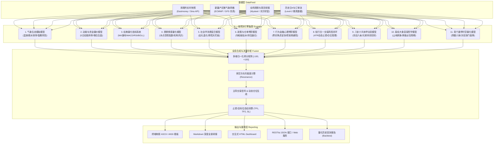

# AI-QUANT：十一维全息量化预测与智能交易系统

[](https://www.python.org/)
[](LICENSE)
[]()
[-red.svg)]()

> **AI-QUANT** 是一套突破传统单一技术分析或纯宏观基本面视角的**全息多维量化研判与交易系统**。系统首创将**物理微气象数值仿真、动力学订单流、经典与量化指标系统、舆情情感挖掘、社会学消费变迁、仓单制度博弈、行为金融群体心理、知行合一交易风控闭环**，以及东方传统象数哲学模型（**八卦六爻纳甲、易经大象变易、时家奇门遁甲**）深度融为一体，构建起跨学科共振的商品期货多空决策中枢。

---

## 架构拓扑图



---

## 十一维预测模型深度拆解

| 序号 | 预测维度 | 核心模型与算法 | 核心输出指标 |
| :---: | :--- | :--- | :--- |
| **1** | **气象生态模拟模型** | 南疆网格微气候模拟、初霜期与相对湿度物候脱水效率函数 | 产区平均温差、吊干脱水效率、裂果霉变风险率 |
| **2** | **动能与资金量价模型** | 动力学加速度斜率、持仓量异动（增仓杀跌判定）、主动订单流 Delta 不平衡度 | 5日动能斜率 (元/日)、ROC变动率、主动卖单占优比 |
| **3** | **经典量化指标系统** | 多周期均线空头瀑布发散、MACD零下二次死叉、RSI(6)/KDJ极度超卖探测、布林带开口 | MA5/10/20、RSI(6)、KDJ(J)、ATR(14)、支撑与阻力位 |
| **4** | **舆情情感量化模型** | 大宗现货社群与研报关键词加权情感倾向、恐慌与贪婪反向指标 | 市场情绪指数 (0-100)、机构做空共识度、一致性陷阱预警 |
| **5** | **社会学消费变迁模型** | 代际饮食结构迁移、去礼盒化与散装量贩替代、全国年需求刚性天花板评估 | 高端礼盒占比、全国年消费天花板 (万吨)、深加工渗透率 |
| **6** | **政策与仓单博弈模型** | 郑商所车船板贴水交割制度溢价挤出效应、“保险+期货”托底现金成本线 | 逼仓风险系数、政策托底成本锚 (元/吨)、仓单流转效率 |
| **7** | **行为金融心理博弈模型** | 枣农吊干结束挂树风损焦虑曲线、现货商创伤应激零库存心理、多头被动投降 | 枣农焦虑妥协指数、贸易商避险指数、羊群踩踏临界点 |
| **8** | **知行合一交易策略闭环** | 王阳明心学交易哲学、“不摸盲底、顺势而为”、ATR动态移动止盈止损 | 移动防守止损位、分批止盈TP1/TP2、建议仓位比例 |
| **9** | **八卦六爻纳甲模型** | 纳甲排盘算法（干支日月令、世应六亲、动爻生克合冲、用神妻财受克、应期推断） | 主卦【地山谦】变【地火明夷】、兄弟申金持世临日、应期立冬 |
| **10** | **易经大象变易哲学模型** | 六十四卦消息卦当令大象、彖辞爻辞意象映射、周期阴阳消长三部曲 | 当令【山地剥】象、剥极必复周期定位、一阳来复节点 |
| **11** | **奇门遁甲时空量化模型** | 时家奇门排盘（阴遁六局、甲申旬、天柱星值符、惊门值使、生门遭天蓬大耗） | 当权兑七宫、双庚当头凶格、生门资金溃散、霜降转局节点 |

---

## 项目目录结构

```
d:\ai\AI-QUANT\
├── .gitignore               # Git 忽略配置
├── requirements.txt         # 项目依赖文件
├── README.md                # 系统架构与使用说明
├── main.py                  # 命令行启动入口
├── cli.py                   # 交互式 CLI 控制台
├── web_app.py               # 独立轻量 Web 可视化看板与 REST API
├── config/                  # 全局配置中心
│   ├── __init__.py
│   └── settings.py          # 市场代码、多维权重、风控阈值配置
├── data/                    # 实时与历史数据接入
│   ├── __init__.py
│   └── data_feed.py         # 东方财富/新浪期货实时行情与K线数据适配器
├── engines/                 # 十一维预测引擎集群
│   ├── __init__.py
│   ├── base.py              # 标准预测结果与抽象基类
│   ├── weather_engine.py    # 1. 气象生态模拟模型
│   ├── momentum_engine.py   # 2. 动能与资金量价模型
│   ├── indicators_engine.py # 3. 经典量化指标系统
│   ├── sentiment_engine.py  # 4. 舆情情感量化模型
│   ├── sociology_engine.py  # 5. 社会学消费变迁模型
│   ├── policy_engine.py     # 6. 政策与仓单博弈模型
│   ├── psychology_engine.py # 7. 行为金融心理博弈模型
│   ├── execution_engine.py  # 8. 知行合一交易策略闭环
│   ├── liuyao_engine.py     # 9. 八卦六爻纳甲全息模型
│   ├── iching_engine.py     # 10. 易经大象变易哲学模型
│   ├── qimen_engine.py      # 11. 奇门遁甲时空量化模型
│   └── fusion_engine.py     # 十一维全息合成总决策引擎
├── backtesting/             # 多维策略量化回测
│   ├── __init__.py
│   └── backtester.py        # 资金管理、交易记录、夏普比率与胜率回测
├── reporting/               # 研报与可视化展现
│   ├── __init__.py
│   └── reporter.py          # 终端彩色看板、Markdown、HTML、JSON 生成器
├── reports/                 # 研报自动归档目录 (.gitkeep)
└── tests/                   # 自动化测试套件
    ├── __init__.py
    ├── test_engines.py      # 11 个子引擎单测
    └── test_fusion.py       # 全息合成与回测集成测试
```

---

## 快速上手与运行指南

### 1. 安装环境
本系统核心算法设计为**零重度外部依赖**即可极速运行；如需使用完整量化与测试功能，可安装推荐依赖：
```bash
pip install -r requirements.txt
```

### 2. 快速生成全景研报 (推荐)
一键对默认主力合约（`CJ2701`）执行全息预测，输出终端看板并生成 Markdown / HTML / JSON 研报：
```bash
python main.py
```

指定其他合约代码（如 `CJ612`, `AP501` 等）：
```bash
python cli.py --symbol CJ2701
```

### 3. 查看期货全月期限结构 (Term Structure)
即时对比近月、主力与远月各合约价差结构：
```bash
python cli.py --term-structure
```

### 4. 运行历史多维量化回测
对历史K线与多维共振信号进行模拟对冲回测：
```bash
python cli.py --backtest
```

### 5. 启动 Web 可视化仪表盘
内置免配置 Web 服务器，提供美观的深色系数据大屏与 REST API：
```bash
python web_app.py --port 8080
# 浏览器访问: http://localhost:8080/
# REST API 访问: http://localhost:8080/api/predict?symbol=CJ2701
```

### 6. 运行自动化测试
```bash
pytest tests/ -v
```

---

## 交易风控与免责声明

1. **模型定位**：本系统综合气象数值模拟、动力学、统计指标及东方象数哲学进行多源交叉验证，旨在提供概率优势与盈亏比不对称机会，并非确定性预言机。
2. **风险控制铁律**：
   * 单一期货品种保证金风险暴露严禁超过总权益的 **15%**。
   * 严格执行移动防守止损纪律，拒绝在单边趋势中“越跌越补”。
3. **法律声明**：期货市场具有高杠杆与高风险特征，投资者应基于个人风险承受能力自主决策，系统开发者不对任何实盘操作盈亏承担责任。
