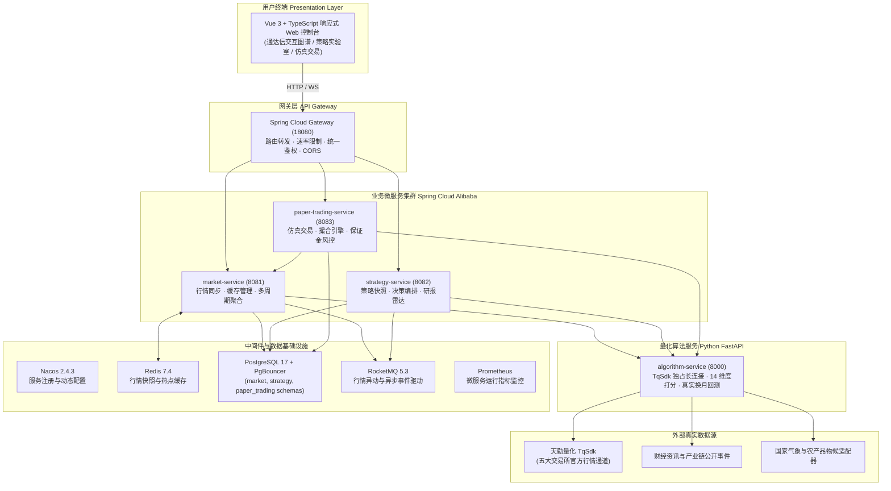

# AI-QUANT · 全维度中国期货实证量化与研判仿真系统

<p align="center">
  
  
  
  
  
  
  
  
</p>

---

## 📌 项目简介

**AI-QUANT** 是一套面向**中国国内期货市场**的企业级分布式量化投研与仿真交易系统。全系统采用云原生微服务架构，动态覆盖**上海期货交易所（SHFE，含上海国际能源交易中心 INE）、大连商品交易所（DCE）、郑州商品交易所（CZCE）、中国金融期货交易所（CFFEX）和广州期货交易所（GFEX）**全部 80+ 活跃挂牌品种及其交割合约。

系统涵盖：
- **通达信级全交互 K 线图表**：Canvas 高性能渲染、全周期、全副图指标、合约梯度月份穿透与买卖五档深度。
- **全维度决策矩阵**：11 个真实数据实证维度（91%）+ 3 个明确隔离的传统时历时序辅助参考（9%）。
- **真实合约回溯实验室**：严格基于**真实交割合约价格与换月移仓证据链**，真实计提跨期价差重置成本、双边手续费与滑点，杜绝合成假数据与未来函数。
- **专业级模拟交易终端**：支持历史时点回放试验与实时行情仿真（LIVE）双模式，具备完整委托撮合、保证金计算与主力自动移仓风控。
- **跨市场机会雷达与线索池**：全市场毫秒级多品种机会异动监控与投研大师研报证据链溯源。

---

## 🏛️ 核心理念与工程原则

1. **绝对保真，杜绝虚构**  
   系统绝不生成演示数据，亦不使用常数或随机漫步拼凑断点。上游行情或历史交割数据不可用时，对应维度与品种显式标记为 `UNAVAILABLE` 或 `DEGRADED` 并退出综合评分，杜绝“用假数据回测出假收益”。
2. **区分主连与交割合约**  
   主连价格（如 `RB0`, `CJ0`）仅用于生成大周期信号；实际成交撮合、止损执行、换月移仓与估值计算**100% 绑定该时点真实交割月合约**（如 `RB2701`, `CJ701`），充分计入真实跨期价差与展期损耗。
3. **实证科学为主，文化参考隔离**  
   综合决策评分包含 11 个实证维度（量价、指标、舆情、供需、持仓拥挤度、跨期价差、期限结构等，合计占比 91%）。另有 3 个非实证时历文化参考（六爻、易经、奇门九星，各占 3%），均由 `lunar-python` 算法基于真实当前时间透明确定性映射，在前端与 API 均以徽章明确标识，保证研究透明度。

---

## 📐 系统全景架构



---

## 🌟 核心功能模块

### 1. 通达信风格专业行情终端 (`/market`, `/market/:symbol`)
- **Canvas 原生渲染**：60 FPS 平滑交互，支持无限历史 K 线缩放（Zoom In/Out）、鼠标滚轮缩放、左右平移与拖拽微缩导览图（Mini-map）。
- **多周期与全副图指标**：日 K、分时线自由切换；副图支持成交量（VOL）、涨跌幅（Change%）、MACD、KDJ、RSI 等常用技术指标。
- **独创合约梯度（Contract Ladder）**：一键穿透查看该品种当前所有挂牌的活跃交割合约列表与实时涨跌，点击任意月份合约即可立即切换图谱与深度。
- **真实深度盘口**：实时买卖五档、最新成交流水明细与持仓增减分析。

### 2. 14 维度全维度决策矩阵 (`/strategy/:symbol`)
系统将交易决策解构为 11 个实证维度与 3 个传统文化时历参考：

| 维度类别 | 维度名称 | 核心真实输入 | 默认权重 | 数据特征与状态说明 |
| :--- | :--- | :--- | :---: | :--- |
| **实证** | **量价动能** | TqSdk 实盘实时行情、真实日 K | 13% | 动量趋势、真实区间价格突破 |
| **实证** | **技术指标** | 真实日 K 多重周期指标集 | 11% | 趋势均线、超买超卖状态 |
| **实证** | **产区气象与物候** | 主产区气象监测站与物候适配器 | 11% | 针对农产品/能化产区；未适配品种显式标记 `UNAVAILABLE` |
| **实证** | **供需压力** | 价格、成交量、持仓量综合分布 | 9% | 仓位堆积与资金博弈 |
| **实证** | **执行与风险** | ATR、真实支撑阻力位、通道区间 | 9% | 盈亏比、止损安全边际测算 |
| **实证** | **持仓拥挤度** | 真实交易所公开持仓量变动 | 8% | 主力席位异动、挤仓风险评估 |
| **实证** | **交割与交易规则**| 交易所当前涨跌停板、保证金率 | 7% | 临近交割月风控限制 |
| **实证** | **新闻舆情** | 东方财富按当前品种过滤之资讯 | 7% | 宏观快讯、行业事件客观情绪 |
| **实证** | **主力跨期价差** | 真实主力与次主力合约实时价差 | 6% | Back / Contango 结构变化 |
| **实证** | **期限结构** | 真实远近交割合约价格分布曲线 | 5% | 期限价差套利机会识别 |
| **实证** | **流动性与波动状态**| 盘口即时量价与历史已实现波动率 | 5% | 冲击成本与流动性风险 |
| **文化参考**| **六爻时历参考** | Asia/Shanghai 真实时间与传统历法 | 3% | 确定性映射，显式标注“非实证文化参考” |
| **文化参考**| **易经时序参考** | 真实日期、卦序与二十四节气映射 | 3% | 确定性映射，显式标注“非实证文化参考” |
| **文化参考**| **奇门时九星参考**| 真实时刻与奇门时九星映射 | 3% | 确定性映射，显式标注“非实证文化参考” |

### 3. 真实交割合约回溯与策略实验室 (`/backtest`)
- **真实移仓换月证据链（Observed Delivery Contract Roll）**：摒弃传统“虚构主连无缝拼接”，回测执行真实交割合约历史序列，对换月日双腿合约价格对齐核算，真实扣除展期价差与双边交易费用。
- **策略绩效全面归因**：精确计算总收益率、年化收益率、最大回撤（Max Drawdown）、夏普比率（Sharpe）、卡玛比率（Calmar）、胜率、盈亏比与按日收益明细曲线。
- **防过拟合与样本外检验**：支持自定义历史区间，并提供品种真实交割数据完备性自检。

### 4. 模拟交易与实时仿真系统 (`/paper`)
- **双时间模式**：
  - **历史时点回放模式**：从历史任意时点起步，逐日单步推进（Advance），在历史真实行情下检验操盘心态与风控纪律。
  - **实时仿真模式（LIVE）**：直连当前实盘行情快照，支持休市时段随时建账开立，开盘时段微秒级同步最新成交与五档盘口。
- **完整订单生命周期**：支持市价单（MARKET）、限价单（LIMIT）、止损单（STOP）、平仓与撤单。
- **风控与结算**：独立虚拟资金账户（初始 ¥1,000,000），按真实交易所合约乘数、保证金率核算占用，合约到期支持自动移仓（Auto-Roll）。

### 5. 跨市场机会雷达与线索池 (`/leads`, `/overview`)
- **全市场机会扫描**：持续扫描 80+ 期货品种，挖掘均线突破、量价背离、期限结构异动等信号。
- **线索分级与分类**：按照方向（多/空）、紧迫度（URGENT/NORMAL）及算法类别归类，提供一键跳转至深度研究工作台。

### 6. 投研导师工作台与研报矩阵 (`/mentors`, `/news`)
- 整合经典量化哲学与期货大师实盘操盘框架，提供可查证的逻辑体系支撑；新闻舆情原始发布源与条件化客观解读实时呈现。

---

## 🛠️ 技术栈全景

| 模块 | 核心技术 / 框架 | 作用说明 |
| :--- | :--- | :--- |
| **前端架构** | Vue 3.5, TypeScript 5, Vite 6, Pinia | 响应式单页面架构，支持桌面与移动端自适应 |
| **图表组件** | HTML5 Canvas 原生引擎, Lucide Vue Next | 通达信级 60FPS 极速渲染、多子图与迷你地图 |
| **微服务网关** | Spring Cloud Gateway, Netty | 统一反向代理、路由分发、限流与安全防护 |
| **后端微服务** | Spring Boot 3.5, Spring Data JPA, Hibernate 6 | 高性能业务调度、账户账本管理与领域模型驱动 |
| **算法服务** | Python 3.11/3.13, FastAPI, Uvicorn | 异步高性能量化分析引擎与决策计算 |
| **量化核心** | TqSdk (天勤量化), NumPy, SciPy, Pandas | 交易所实盘数据源接收、矩阵分析与回测计算 |
| **文化时历库** | `lunar-python` | 农历、节气与传统时空映射的确定性纯算法实现 |
| **消息总线** | Apache RocketMQ 5.3 | 异步事件分发、订单事件流与行情解耦 |
| **分布式缓存** | Redis 7.4 (Alpine) | 行情快照、五档微观结构与热点数据毫秒级缓存 |
| **关系型数据库** | PostgreSQL 17.6 + PgBouncer | 强一致性业务持久化（三独立 Schema）与高性能连接池 |
| **服务治理** | Nacos 2.4.3 | 服务注册中心与动态配置中心 |
| **容器与监控** | Docker Compose, Prometheus 3.5 | 一键容器化部署、健康检查探针与性能指标收集 |

---

## 📂 工程目录结构

```text
AI-QUANT/
├── algorithm_service/          # Python 算法服务 (FastAPI, 14 维度决策, 策略计算)
│   ├── app.py                  # API 路由与业务控制器
│   └── ...
├── backend/                    # Java 微服务集群 (Maven Multi-module)
│   ├── gateway-service/        # Spring Cloud Gateway 网关服务
│   ├── market-service/         # 行情调度微服务 (PostgreSQL market schema)
│   ├── strategy-service/       # 策略与线索微服务 (PostgreSQL strategy schema)
│   ├── paper-trading-service/  # 模拟交易与撮合微服务 (PostgreSQL paper_trading schema)
│   ├── maven-settings.xml      # Maven 官方中央仓库加速配置
│   └── pom.xml                 # 父 POM 依赖管理
├── frontend/                   # Vue 3 前端工程
│   ├── src/
│   │   ├── components/         # Canvas 图表 (TongdaxinChart)、指标卡、挂单列表等
│   │   ├── views/              # 市场总览、行情、研究、回测、模拟交易等主页面
│   │   ├── router.ts           # 路由与导航守卫
│   │   └── services/           # API 客户端封装
│   └── package.json
├── backtesting/                # 历史回测分析引擎与证据验证库
├── data/                       # 数据适配器 (TqSdk 连接器、产区物候、新闻过滤)
├── engines/                    # 决策融合算法引擎 (11+3 维度评估体系)
├── infrastructure/             # Docker Compose 生产与开发环境编排
│   ├── docker-compose.yml      # 全套 12 个服务容器编排清单
│   └── .env.example            # 环境变量示例模板
├── docs/                       # 架构设计、验证记录与运维手册
│   ├── operations.md           # 生产运行与运维排错手册
│   └── verification.md         # 验收标准与测试基准记录
└── tests/                      # Python pytest 全量测试集 (163 用例)
```

---

## 🚀 快速上手与部署

### 方式一：Docker Compose 一键启动（推荐）

#### 1. 环境准备
确保本机已安装：
- [Docker Engine](https://docs.docker.com/engine/install/) (>= 24.0) 及 [Docker Compose](https://docs.docker.com/compose/) (>= 2.20)

#### 2. 配置环境变量
```bash
cd infrastructure
cp .env.example .env
```
用编辑器打开 `.env` 文件，按需配置：
```ini
# 天勤量化 TqSdk 凭据 (用于拉取真实行情与历史交割数据，可在天勤官网免费注册)
TQSDK_USERNAME=your_tqsdk_username
TQSDK_PASSWORD=your_tqsdk_password

# 端口配置 (默认即可)
FRONTEND_PORT=8088
GATEWAY_PORT=18080
```
> [!NOTE]
> 若暂无 TqSdk 凭据，系统将自动降级为公开行情源与已缓存真实历史合约数据，核心功能均可正常体验。

#### 3. 构建并启动容器栈
```bash
docker compose --env-file .env up -d --build
```

#### 4. 访问服务
服务启动就绪后（约 1-2 分钟），可在浏览器中直接打开：
- 🖥️ **Web 控制台界面**：`http://localhost:8088`
- 🌐 **API 网关接口入口**：`http://localhost:18080`
- 🩺 **系统就绪探针**：`http://localhost:18080/actuator/health/readiness`
- 📊 **Prometheus 监控**：`http://localhost:9090`

---

### 方式二：本地研发调试启动

#### 1. 前端开发环境
```bash
cd frontend
npm install
npm run dev
# 启动本地开发服务器，默认端口 5173
```

#### 2. Python 算法服务
```bash
# 建议使用 Python 3.11 或 3.13
pip install -r requirements.txt
python -m uvicorn algorithm_service.app:app --host 0.0.0.0 --port 8000 --reload
```

#### 3. Java 后端服务
```bash
cd backend
mvn -s maven-settings.xml clean package -DskipTests
# 分别运行各微服务
java -jar gateway-service/target/gateway-service-*.jar
java -jar market-service/target/market-service-*.jar
java -jar strategy-service/target/strategy-service-*.jar
java -jar paper-trading-service/target/paper-trading-service-*.jar
```

---

## 🧪 测试与质量验证

项目遵循严苛的金融软件测试标准，包含完整的单元测试、集成测试与容错断网测试：

```bash
# 1. 运行 Python 全量测试 (163 个用例全部通过)
python -m pytest tests/ -v

# 2. 运行前端 Vitest 测试 (67 个用例全部通过)
cd frontend
npm test

# 3. 运行前端生产环境构建检查
npm run build
```

---

## 🔒 风险披露与合规声明

1. **仅供研究学习**：本系统属于量化投研工具与算法实验平台，所有策略评分、胜率推演与雷达提示**均不构成任何实盘投资建议或操盘保证**。
2. **拒绝自动带单**：系统内模拟交易（Paper Trading）仅在本地或私有数据库进行虚拟记账与撮合，不包含任何实盘资金划转、代客理财或自动跟单功能。
3. **数据版权与授权**：用户需自行确保所使用数据源（如天勤量化 TqSdk、财经新闻等）符合服务提供商的授权协议与国内金融合规监管要求。
4. **凭据安全提示**：请妥善保管 `.env` 中的数据库密码及数据平台凭证，严禁将私密配置提交至公共代码仓库。

---

## 📄 开源许可证

本项目基于 [MIT License](LICENSE) 许可证开源，欢迎量化爱好者、学术研究者提交 Issue 或 Pull Request 共同完善！
