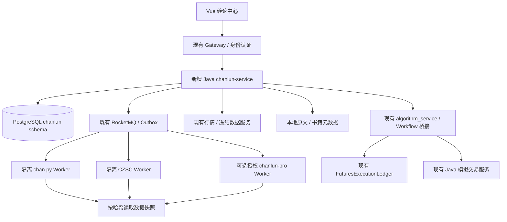

# AI-QUANT 缠论中心设计

日期：2026-10-31。状态：第一期日线研究工作台已实施，其余为后续设计。产品优先级：一级独立模块。实际交付范围与验证见 [运行说明](../../chanlun-center.md)。

**后续决策覆盖原授权路线：**用户要求自己实现并超过 chanlun-pro。当前默认引擎为独立实现的 `aiquant-chan-v1`；原文后续提到的 pro 授权适配、授权 Worker 与等待授权阶段均已撤销，保留为设计历史。当前目标、已实现口径与限制见 [自研目标](../chanlun-native-goal.md)。

## 1. 产品决策

在主导航新增「缠论」，入口 `/chanlun`，模块名称「缠论中心」，默认打开「缠论工作台」。围绕“读懂原文 → 看懂结构 → 记录当时判断 → 验证交易条件 → 回测与模拟 → 复盘修正”形成完整闭环。使用本系统已有的品种、数据、书籍、研究和模拟账户，不另建一套孤立交易系统。

采用**多引擎、统一证据、统一执行**架构：chan.py 优先提供公开结构计算；CZSC 用于信号研究与批量组合；chanlun-pro 作为取得有效授权后的可选引擎，同时参考其成熟工作流；现有 `fu-chanlun-causal-v1` 保留为单独命名的研究基线。产品、时间语义、研究协议和执行账本由 AI-QUANT 控制。

“比他们更好”先落实到可检查的体验与可信度：看到任一候选信号，都能回答它依据什么、何时才知道、后来怎样修订、当时是否能成交、扣除成本后怎样，以及对应哪段原文。是否具备收益优势，必须通过后续研究证明。

本轮交付完整设计、交互布局预览和真实历史结构样本。预览只演示工作台交互，不代表八个页面已实现，也不构成正式盲回放。

## 2. 三个项目怎样吸收

| 来源 | 吸收的核心价值 | 在本系统的位置 | 必须保留的边界 |
|---|---|---|---|
| chan.py | 分型、笔、特征序列线段、中枢、买卖点、多级别关联 | 默认结构研究适配器、原文与规则对照 | MIT 公开计算模块；README 中完整版的模型、AutoML、交易能力不能当成公开实现 |
| CZSC | 多周期信号、事件与持仓研究、批量实验与统计组织 | 研究适配器、信号雷达、组合实验 | Apache-2.0；当前核心 `zs_list` 与 chan.py 线段/中枢体系不能直接等同 |
| chanlun-pro | 看盘、图层配置、多图联动、选股监控、回放、策略与交易工作流；公开 ICL 接口 | 可选授权适配器；专业看盘体验的参考 | 外围 Apache-2.0；计算核心、运行时和授权材料有独立专有边界 |
| 本项目 | 原文内置阅读、已冻结数据、研究留痕、真实合约账本、模拟账户 | 用户入口、证据协议与交易控制 | 现有研究口径仍单独具名，不包装为原文唯一标准 |

固定审阅版本：

- CZSC：`5d350a943d6b1935561765fed5467c234973d121`；实测运行包 `czsc==1.0.2`、`wbt==0.9.2`，源码提交与发布 wheel 分开登记。
- chan.py：`f8ca3b5e44d7166e2abd756a8e7fa816c79faebe`。
- chanlun-pro：`77973e0863b847a01e33c11383635a2943679041`。只审阅公开说明、接口和文档；未安装或执行专有核心。

chanlun-pro 当前根 README 明确排除 `src/chanlun/core/`、`src/pyarmor_runtime_*/`、`licenses/` 等，要求单独、绑定机器的有效授权。适配器预留接口即可推进设计；启用前需要核实部署、容器重建、机器迁移和并发实例对应的授权条件。界面状态为“待授权”，不会显示伪造计算结果，也不会偷偷使用另一引擎并继续标为 pro。第三方 TradingView 图表资源的授权另算；本系统优先演进现有图表。

来源：[chanlun-pro 许可范围](https://github.com/yijixiuxin/chanlun-pro#license-and-scope--许可范围)、[公开 ICL 接口](https://github.com/yijixiuxin/chanlun-pro/blob/77973e0863b847a01e33c11383635a2943679041/src/chanlun/cl_interface.py)、[CZSC](https://github.com/waditu/czsc)、[chan.py](https://github.com/Vespa314/chan.py)。详细实测见 [CZSC 与 chan.py 研究](../../research/czsc-chanpy-review-2026-10-31.md)。

## 3. 信息架构与页面

主导航只有一个新入口，内部使用二级导航。页面共享品种、引擎、规则版本、数据快照和观察时点，不反复要求用户选择。

| 页面与路由 | 用户任务 | 主要内容与联动 |
|---|---|---|
| 工作台 `/chanlun/workbench` | 理解当前结构、形成判断 | K 线与结构图层、多级别联动、结构树、证据面板、原文侧栏、观察时间轴 |
| 信号雷达 `/chanlun/radar` | 从自选品种找到值得观察的机会 | 候选/符合规则/已失效/数据陈旧分组；解释触发和失效条件；进入同一时点的图表 |
| 回放训练 `/chanlun/replay` | 在未知后续走势时练习 | 服务端逐根推进、判断与标注先提交、再揭示结构变化与交易结果 |
| 引擎对照 `/chanlun/compare` | 理解划分分歧 | 同数据同观察时点并排；定位首次分歧、参数和结构谱系；不以多数投票判真伪 |
| 策略实验 `/chanlun/lab` | 把规则变成可复现实验 | 版本化条件、参数、基准、数据分割、成本压力测试；发布到模拟前做影子观察 |
| 原典课堂 `/chanlun/academy` | 联系原文与实图 | 本地 108 课、概念索引、原文/实现解释分栏、已审核案例与练习 |
| 复盘档案 `/chanlun/reviews` | 检查判断和执行偏差 | 当时截图/结构快照、事件、订单、批注与原文引用；个人总结双向关联 |
| 规则与引擎 `/chanlun/settings` | 管理研究口径与运行健康 | 规则版本、引擎能力/授权、数据质量、任务、监控心跳、失败重试 |

核心流程：雷达命中 → 工作台同一时点 → 点击结构看证据 → 打开原文 → 保存判断 → 策略实验 → 影子观察 → 发布到已有模拟账户 → 复盘。每一步携带上下文与来源，不复制出无法追溯的新结果。

## 4. 工作台交互设计

### 4.1 桌面布局

顶部显示品种、数据模式（冻结历史/实时观察/影子观察）、引擎、规则版本、数据健康。第二行提供周期与布局选择、图层开关。中央图表优先，右侧为所选对象的证据；底部为观察时点、事件修订和已保存判断。原文以侧栏打开，保留当前图表与十字线位置。

提供两种可保存布局：

- **图表优先**：约 72% 图表、28% 证据，适合看盘。默认单图，可切双图/三图。
- **证据优先**：顶部完整图表，下方并列结构事实与规则说明，适合研究与教学；避免窄侧栏塞入长段解释。

双/三图按共同观察时点联动十字线、标记与选择；不同周期各取真实数据。首期仅开放已验证日线。日/30 分钟/5 分钟是后续目标组合，分钟数据未接入前禁用对应选项，说明缺失原因。不得由日线生成假的小周期。

窄屏按图表、证据、时间轴堆叠；保留所有重要状态。桌面快捷键与鼠标缩放不是唯一操作方式。图表使用中国市场默认红涨绿跌，同时用线型、箭头与文字区分状态，并允许切换颜色习惯。

### 4.2 图层与选择

图层包括原始/包含处理 K 线、分型、笔、线段、递归线段、中枢、候选买卖点、背驰证据、MACD、订单和用户标注。按引擎能力开放；某引擎缺少对应层就显示“不提供”，不静默拼接其他引擎。

点击任一结构，统一选中图中标记、结构树和事件轨迹。证据面板依次展示：对象与状态、构成 K 线/子结构、端点与观测时间、引擎原始字段、规则参数与解释、失效/修订历史、关联课号。具体课号由人工审核映射，记录映射版本；相似关键词不能自动成为原文论证。

候选虚笔使用虚线；引擎确定使用实线；“已确定”旁注明引擎口径。允许交易条件另列，未经发布策略评估时显示“未评估”，不能把 `is_sure` 翻译为“可买入”。黑盒引擎只能展示其实际提供的证据粒度，不能编造内部判定过程。

原文阅读复用已有本地 `ChanlunReader`、108 课与本地图片，补充课号、段落锚点和可回到原图的内部深链接。书籍页继续保留原入口；缠论模块无需跳转外站、外部 iframe 或登录第三方网站。

### 4.3 回放与训练

研究回放允许查看完整已选区间；盲训练必须由服务端控制推进，只返回 `availableAt <= asOf` 的行情和当时逐根计算的状态。未来行情、最终图和未来成绩不能提前进入客户端载荷、隐藏 DOM 或导出接口。最终图按端点日期过滤不能还原当时状态。

每次先保存用户标注、候选方向、失效条件与理由，再揭示下一根。结构理解按所选规则版本评估，不能把某一引擎划分当作所有缠论解释的唯一标准。交易结果单独评价；“结构标得像”不等于“赚钱”。训练题分配与实验集分开，已经看过结局的题标记为复习。

### 4.4 雷达与监控

雷达先显示候选结构及条件，不把所有候选命名为交易机会。每条记录附引擎、规则版本、周期、观察时点、最新事件、数据新鲜度和撤回原因。筛选保存为服务端任务，离开页面仍能运行。

监控需要行情水位、实例心跳、重启恢复、去重、过期抑制和通知偏好；数据断流时暂停新信号并标记陈旧，恢复后按水位补算。相同结构修订通知合并；策略实例与观察任务分离。通知渠道默认关闭，由用户配置后启用，不能以浏览器开着等同于持续监控。

## 5. 统一结构、信号与时间语义

### 5.1 事实依据

已对两个公开引擎使用同一 1,894 根 FU 日线逐根实验：CZSC `finished_bis` 出现过 45 次相邻状态移出；chan.py `is_sure` 笔出现过 155 次。移出可能是修订、延伸、撤回或后续重现，不等同于错误或亏损。四个前缀检查点的笔集合与相同前缀重建一致。结果支持记录观察和修订，不能支持“完成字段永久不变”。详细口径与限制见研究报告。

### 5.2 协议

`StructureObservation v1` 为统一外壳，保留原始引擎语义：

| 字段组 | 必需字段和含义 |
|---|---|
| 可复现来源 | `datasetId, datasetHash, runId, engineId, engineVersion, adapterVersion, profileId, profileHash, symbol, frequency, priceBasis` |
| 对象身份 | `logicalStructureId, type, direction, parentRefs, constituentRefs`；ID 在引擎内稳定，端点变化创建修订，不能仅以端点散列作为永久身份 |
| 市场结构 | `pivotStartAt, pivotEndAt, valueRange`；这是图上结构的位置 |
| 观测事实 | `observedAsOf, firstObservedAt, engineConfirmedAt, eligibleAt, recordedAt`；分别记录当前观察界限、首次可见、引擎确认、策略最早允许动作、实际写入时间；未知值为空 |
| 版本与审计 | `revision, eventSeq, priorRevisionRef, state, reasonCode, rawEngineFlags, evidenceRefs` |

历史日线日期只是交易日标签；`availableAt` 需要行情日历、收盘与提供方可得时间，不能当成当日 00:00 已知。回放虚拟时间与现在运行任务的 `recordedAt` 分开。`eligibleAt` 由已发布策略结合数据可得性和撮合规则得出，不由结构引擎直接决定；也可能始终为空。

事件追加写入：`OBSERVED, REVISED, ENGINE_CONFIRMED, RETRACTED`。交易资格另走 `ELIGIBLE, INVALIDATED` 信号事件。撤回保留旧记录，已发订单仍保留其当时依据。状态物化视图可以更新，审计事件不覆盖。

跨引擎映射只作为带方法与置信说明的“区间对应关系”，不强求一一对应。引擎间计数差异不是准确率；共同叫“中枢”也可能基于不同结构层级。

### 5.3 参数与规则版本

每个 `RuleProfile` 绑定引擎与适配器版本，区分引擎原生参数、标准化显示选项和策略资格条件。发布时计算不可变哈希；修改生成新版本。网页只接受类型明确的白名单字段与枚举，禁止任意表达式/代码直通第三方配置。

适配器能力清单明确支持的结构、周期、增量、重建、状态导出、证据粒度和运行环境。初期不承诺跨版本序列化引擎内部对象；采用输入水位和规范化检查点，必要时从最近可信前缀重放。

## 6. 技术架构与本项目融合

### 6.1 服务边界

- 新增 `backend/chanlun-service`：管理规则、数据引用、任务、观察事件、回放会话、雷达订阅与复盘关联。使用独立 `chanlun` schema、独立 Flyway V1 起步，不改写 paper 已执行迁移。
- Python Worker 按引擎拆环境，固定依赖和镜像摘要。CZSC 的 Rust/wheel 依赖、chan.py 的顶层包名、pro 的授权运行环境均避免污染现有算法服务。先运行相同协议的本地/容器任务，再考虑扩容；不假设已有 Windows 测试等于 Linux Docker 兼容通过。
- pro Worker 仅在授权有效且部署方式获支持时启用。可使用合法授权的独立主机 Worker，不强制装进同一个 Compose；禁止复制许可证、模拟机器指纹或通过重新打包绕过限制。
- 数据来源和真实交易账户继续归既有服务。研究输出通过版本化桥接进入现有算法与模拟流程，缠论服务没有绕过风控直接下单的通道。
- 长任务使用既有消息设施、租约与心跳；协议版本与数据哈希入任务。默认至少一次投递，消费者幂等；超时重试有上限、退避和死信。Outbox 使落库与发事件保持一致。

### 6.2 前端落点

在 `frontend/src/router.ts` 注册 `/chanlun` 父路由，`frontend/src/layouts/AppShell.vue` 添加一级导航。新增模块目录 `features/chanlun/`，集中状态、协议类型和页面；共享数据加载使用现有服务习惯。

现有 `TongdaxinChart.vue` 为 SVG 图表，已有 K 线、MA/MACD、缩放与平移。分阶段抽出视口、坐标映射、十字线和结构覆盖层接口；保留原市场页回归检查。需要接口：`viewportChanged, crosshairChanged, selectionChanged`，输入 `bars, overlays, visibleRange, observedAsOf, selectedObjectRef`。先用 SVG 验证正确性，只有性能基准失败后才考虑 Canvas/WebGL，避免先重写图表。

工作流新增 `CHAN_SIGNAL` 节点：引用已发布引擎/规则/资格策略和数据口径，提供与当前节点体系相容的 `buy/sell/close` 布尔端口；证据引用作为执行上下文保存。升级 DSL 和执行引擎版本，不能让旧工作流随默认引擎升级而改变结果。当前链路是日线工作流，不能仅增加下拉选项就声称支持分钟交易。

### 6.3 API 草案

所有外部接口沿用登录、用户权限和资源归属校验；客户端不能指定其他用户的 run 或回放会话获取数据。

| API | 用途 |
|---|---|
| `GET /api/chanlun/v1/engines` | 能力、版本、可用性；只返回脱敏授权状态 |
| `POST /api/chanlun/v1/profiles`、`POST /profiles/{id}/publish` | 草稿与不可变规则版本 |
| `POST /api/chanlun/v1/runs` | 使用幂等键创建结构/对照/实验任务，返回任务 ID |
| `GET /api/chanlun/v1/runs/{id}`、`POST /runs/{id}/cancel` | 进度、水位、失败原因与取消 |
| `GET /api/chanlun/v1/runs/{id}/structures?asOf=…` | 当时可见结构及证据，服务端执行时点约束 |
| `GET /api/chanlun/v1/runs/{id}/events?afterSeq=…` | 按序恢复事件；支持后续 SSE 推送，游标可恢复 |
| `POST /api/chanlun/v1/replays`、`POST /replays/{id}/advance` | 建立回放与服务端推进，推进幂等且串行 |
| `POST /api/chanlun/v1/replays/{id}/decisions` | 在揭示前提交判断，记录所见状态摘要 |
| `POST /api/chanlun/v1/monitors` | 创建持久监控，能力与行情检查通过后启动 |
| `POST /api/chanlun/v1/reviews` | 保存结构、原文锚点、判断与订单引用 |

Worker 内部接口至少包括 `capabilities, validateProfile, buildPrefix, advance, exportObservations, health`；不向浏览器暴露文件路径、Python 对象或执行配置代码的能力。

### 6.4 数据与任务

建议表：`engine_registration, rule_profile, dataset_ref, analysis_run, run_checkpoint, structure_event, structure_current, signal_event, replay_session, replay_decision, monitor, monitor_delivery, review, lesson_link, outbox_event`。事件按 run 和序号索引；量大后按运行/时间分区。检查点与图表切片可以清理，已发布实验与模拟交易所引用证据须保留。

任务状态：`QUEUED → RUNNING → SUCCEEDED/FAILED`，取消通过 `CANCEL_REQUESTED → CANCELLED`。许可缺失为 `BLOCKED_LICENSE`，数据缺失为具名失败原因，均不生成“成功但空白”的结果。任务失败不自动切换引擎；恢复必须使用同版本、同配置、同数据，或明确创建新 run。

## 7. 行情、期货与研究可信度

### 7.1 行情标准

记录交易所时区、交易日/夜盘归属、开闭市、bar 收盘与可得时间、供应方修订、缺失/重复和停牌。只喂已完成 K 线；有成交量不代表已收盘。高周期由真实低周期、对应日历和收盘水位聚合，等待其组成数据完整。

信号价格与成交价格分开。连续合约采用具名换月/复权口径并保存每次换月证据；绝不以连续信号价直接撮合真实账户。本次预览的数值是向前比价链的连续信号价格，不是当时真实交割合约可成交报价。

CZSC 当前运行包需无时区输入：先转换市场时区再移除时区。chan.py 显式控制 `CTime.auto`，跨服务 epoch 不依赖主机默认时区。缺失成交额不能填零后运行依赖真实成交额的信号；缺失能力明确禁用。

### 7.2 交易执行

候选信号通过发布资格规则后，先进入影子观察；正式实验复用 `FuturesExecutionLedger`，模拟交易复用 Java 现有账户与幂等保护。两条链路使用同一信号证据协议，通过回归用例核对语义；不假设两个账本已逐笔一致。

执行需要真实交割合约、下一可执行时刻、整数手数、保证金、手续费、滑点、限价/涨跌停、夜盘与移仓。不能用历史结构端点直接回填订单，也不能使用同根收盘信号在同一收盘价无条件成交。持仓失败、拒单、部分成交与现金不足保留事件。

### 7.3 实验设计

冻结数据、版本、费用、候选参数预算、目标与选择规则后，比较：原有研究基线、朴素突破/回撤策略、单引擎规则、多周期条件和组合条件。固定共同风险预算，报告净收益、回撤、换手、暴露、交易数、参数敏感性、成本压力与失效阶段。按时间划分并做滚动验证，防止选择大量规则后只展示最好结果。

现有 2019—2026 FU 数据已用于研究，后续再切分只能称回溯验证；不再宣称是全新未见样本。真正样本外结论需要冻结规则后的新数据/前向观察。多引擎一致可以作为待检验条件，不能天然提高置信度或构造“准确率 95%”。

AI 首期用于解释已检索证据、查原文和草拟复盘；每条解释链接到结构字段、事件与本地原文。规则判定、账本和最终交易资格由确定性逻辑控制。没有证据就显示无法判断；AI 不替用户自动修改已发布策略。

## 8. 怎样验收“做得更好”

以下是本项目的建设目标，不是已测得的性能或对其他项目的全面排名。

| 维度 | 具体验收 |
|---|---|
| 当时可知 | 已登记基准样本每个检查点的前缀重建与增量输出一致；盲回放响应中无未来数据；反例必须阻止发布 |
| 可追溯 | 每个发布信号和模拟订单可回到版本、数据哈希、资格规则、当时结构与修订链，无孤立订单 |
| 规则透明 | 支持的结构有参数与原始字段；黑盒证据缺口明确标示；引擎不支持层不能冒用 |
| 原文联动 | 从有已审核映射的结构到本地原文不超过两次操作；无对应原文时明确显示未建立映射 |
| 真实执行 | 换月、费用、保证金不足、重复信号、收盘可得时间、夜盘归属案例有可复现结果 |
| 日常看盘 | 保存品种/布局/图层；图表、证据与时间轴选择一致；宽窄屏均能完成主要流程 |
| 可运维 | 任务可取消、重启可恢复、重复消息不重复发布；授权失效阻止新任务，历史结果和书籍仍可读 |
| 性能目标 | 指定硬件下，72—2,000 根可见 K 线与约 1,000 个覆盖对象，缓存首帧 p95 <1.5 秒、交互 p95 <100ms；先实测再决定优化 |

吞吐量按品种×周期×引擎×规则数做容量基准，设资源配额。历史研究队列与实时观察队列隔离，避免大回测拖慢监控。审计包含任务失败率、数据水位滞后、引擎耗时与消息积压。

## 9. 分期实施与放行条件

依赖顺序优先于工期承诺；每期形成完整可用闭环，不能以八个空菜单代替模块。

| 阶段 | 可交付能力 | 放行条件 |
|---|---|---|
| A：可信工作台 | 独立入口、单品种日线、chan.py/CZSC 适配、现有基线、图层/证据、前缀回放、本地原文 | 版本与价格口径可见；时间/修订协议通过；跨引擎不混画；现有市场与书籍回归通过 |
| B：对照与训练 | 结构分歧定位、服务端盲回放、判断留痕、原文案例、复盘档案 | 未来数据泄漏检查通过；检查点重建一致；判断先于揭示；映射经审核 |
| C：策略闭环 | CHAN_SIGNAL、成本完整实验、风险与基准比较、影子观察、已有模拟账户接入 | 确定性重跑、订单可追溯、重复与拒单用例通过；风险/账户回归通过 |
| D：分钟与雷达 | 验证分钟来源、交易日历、多周期联动、后台自选监控与健康告警 | 数据完整和可得时间可信；断流/恢复/重启/去重演练通过；容量基准通过 |
| E：pro 与深化 | 合法授权 Worker、ICL 对照、更多市场、规模化研究、辅助解释 | 授权和容器/主机运行方式明确；同输入/同协议核验；所有差异标明 |

pro 授权适配可以在任一期并行推进；它不是 A—D 的阻塞依赖。授权有效也不自动证明其结果优于公开引擎，仍需同一协议验证。真实账户交易不包含在本轮设计交付或默认实施授权内。

第一期的关键交付应是一条能完成的任务：“选 FU → 看截至某日的真实结构 → 查看它当时如何形成 → 对照另一引擎 → 读对应原文 → 保存自己的判断”。后续训练、研究、雷达与模拟都复用这条证据链。

## 10. 本轮预览与复现

预览比较「图表优先」与「证据优先」布局，支持切换公开引擎、四个历史检查点、笔/线段/中枢图层和结构证据；pro 只展示待授权状态。原文侧栏仅为入口布局样例，不替代现有完整读本。没有收益、胜率或实时数据占位值。

样本为现有冻结 FU 数据，2019-01-02—2026-10-27，共 1,894 根日线、33 次换月。SHA-256：`f069d8c21ec41d106f4b21c90f9e04d4d285d00847c8f551ff11991e38768577`。逐根计算后导出第 1,814/1,854/1,874/1,894 根的真实状态，各显示尾部 72 根；图形输出四舍五入到五位小数，不用于撮合。

设计样本：[prototype-snapshots.json](prototype-snapshots.json)。生成脚本：[export_design_snapshots.py](export_design_snapshots.py)。运行要求与依赖锁定见研究报告；脚本使用本机研究 checkout，路径通过参数指定。交互预览载入了所有检查点，只能称设计预览，正式盲训练要按本设计的服务端隔离实现。

待实施时解决的具体事项：分钟行情来源与授权、pro 运行授权、各引擎规则与原文映射审核、部署硬件容量和前向观察窗口。以上事项不会妨碍先完成日线可信工作台。

### 本轮验证记录

2026-10-31：生成脚本重跑成功，四个检查点与预览内嵌数据完全一致；核对行情与结构端点均未超过各自观察界限，JavaScript 语法检查通过。浏览器验证了公开引擎切换、CZSC 线段能力禁用、pro 待授权不显示结构、历史时点更新、对照表、图层开关和两种布局。360/320 像素视口检查无横向溢出，图表按实际容器宽度重绘。以上属于设计预览验证，正式服务端回放、任务和交易链路仍按分期实施与验收。
