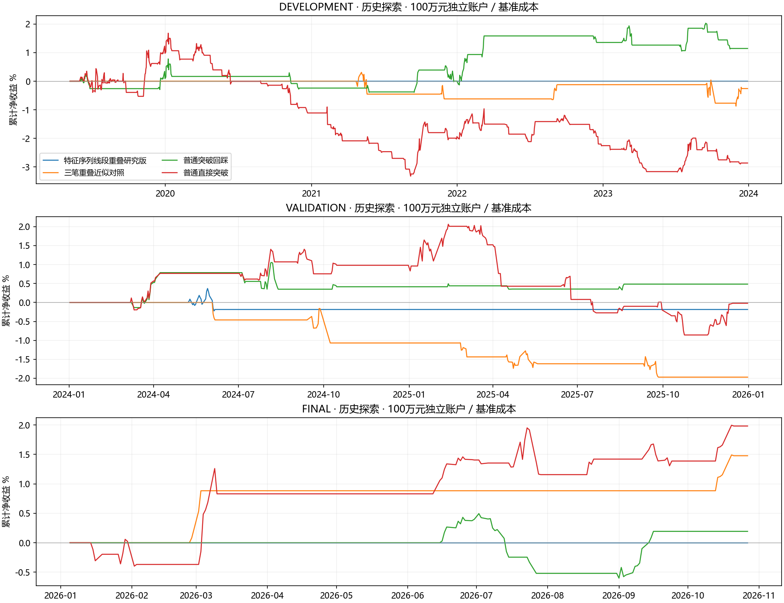
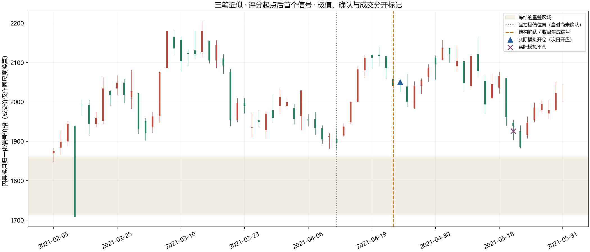

# 燃油：缠论结构与突破回踩研究

冻结日期：2026-10-30。真实FU交割合约日线 1894 根，2019-01-02 至 2026-10-27。

完成180个场景；通过预定全部门槛：0组。所有窗口已在其他研究中使用，本轮属于历史探索。

## 本轮回答什么

检验固定底层上的特征序列线段重叠、三笔重叠近似，是否比普通突破回踩或直接突破增加可交易价值。只检验本文冻结的研究版本，不把它等同于原著全部递归走势类型，也不据此断言整个缠论有效或无效。

线段研究版采用第67课有/无特征序列缺口的两种确认路径；特征元素包含按当前段方向合并。数据开头可能位于未完成线段中，先跳过不满足三笔交集的未知前缀；一旦建立起点就不再跳过或回写已发布结构。保守确认笔需要再一个合法反向端点，确认延迟是规则的一部分。

## 固定中心规则结果

下表均为100万元独立账户、基准模型成本、整个窗口累计净收益；不是年化收益，不是四组资金合并为一个账户。

| 研究版本 | 窗口 | 累计净收益 | 收盘回撤 | 平仓笔数 | 双倍成本收益 |
|---|---|---|---|---|---|
| 特征序列线段重叠研究版 | 2019—2023 | +0.000% | 0.000% | 0 | +0.000% |
| 特征序列线段重叠研究版 | 2024—2025 | -0.185% | 0.590% | 1 | -0.191% |
| 特征序列线段重叠研究版 | 2026至快照末日 | +0.000% | 0.000% | 0 | +0.000% |
| 三笔重叠近似对照 | 2019—2023 | -0.256% | 1.179% | 5 | -0.061% |
| 三笔重叠近似对照 | 2024—2025 | -1.970% | 1.970% | 5 | -1.999% |
| 三笔重叠近似对照 | 2026至快照末日 | +1.478% | 0.013% | 2 | +1.471% |
| 普通突破回踩 | 2019—2023 | +1.146% | 1.160% | 17 | +1.061% |
| 普通突破回踩 | 2024—2025 | +0.484% | 0.719% | 8 | +0.395% |
| 普通突破回踩 | 2026至快照末日 | +0.193% | 1.091% | 3 | +0.187% |
| 普通直接突破 | 2019—2023 | -2.862% | 4.919% | 63 | -3.041% |
| 普通直接突破 | 2024—2025 | -0.022% | 2.863% | 21 | -0.225% |
| 普通直接突破 | 2026至快照末日 | +1.983% | 0.779% | 12 | +1.940% |

## 结构确认究竟有多晚

| 版本 | 全历史确认事件 | 笔 | 线段 | 重叠区域 | 极值至确认中位交易日数 | 最大交易日数 |
|---|---|---|---|---|---|---|
| 特征序列线段重叠研究版 | 1 | 141 | 12 | 4 | 70 | 70 |
| 三笔重叠近似对照 | 12 | 141 | 12 | 51 | 9.5 | 13 |
| 普通突破回踩 | 42 | 0 | 0 | 0 | 0.0 | 0 |
| 普通直接突破 | 236 | 0 | 0 | 0 | 0.0 | 0 |

计数是同一历史内的确认事件；并非全部都成交，也不是独立策略数量。笔/段可能使用了日线之前的完整预热，分窗口账户仍从规定评分起点开始。

结构极值可以画在过去，但订单只在确认之后的开盘产生。末尾未完成结构保持未完成，绝不拿完整历史重算后回填低点成交。确认后若已触及区域、开盘跳回无效边界、换月或风险不足，则取消。

图例固定选择评分起点后首个三笔近似信号，未按盈利挑图。K线使用因果换月信号尺度；实际模拟成交标记按该日比例换算到同一尺度，账本保留真实合约原价。

## 不同资金规模

| 版本 | 窗口 | 初始资金 | 累计净收益 | 平仓笔数 | 不足一手拒单 |
|---|---|---|---|---|---|
| 特征序列线段重叠研究版 | 2024—2025 | 10,000 | +0.000% | 0 | 1 |
| 特征序列线段重叠研究版 | 2024—2025 | 100,000 | +0.000% | 0 | 1 |
| 特征序列线段重叠研究版 | 2024—2025 | 1,000,000 | -0.185% | 1 | 0 |
| 特征序列线段重叠研究版 | 2026至快照末日 | 10,000 | +0.000% | 0 | 0 |
| 特征序列线段重叠研究版 | 2026至快照末日 | 100,000 | +0.000% | 0 | 0 |
| 特征序列线段重叠研究版 | 2026至快照末日 | 1,000,000 | +0.000% | 0 | 0 |
| 三笔重叠近似对照 | 2024—2025 | 10,000 | +0.000% | 0 | 5 |
| 三笔重叠近似对照 | 2024—2025 | 100,000 | +0.000% | 0 | 5 |
| 三笔重叠近似对照 | 2024—2025 | 1,000,000 | -1.970% | 5 | 0 |
| 三笔重叠近似对照 | 2026至快照末日 | 10,000 | +0.000% | 0 | 2 |
| 三笔重叠近似对照 | 2026至快照末日 | 100,000 | +0.000% | 0 | 2 |
| 三笔重叠近似对照 | 2026至快照末日 | 1,000,000 | +1.478% | 2 | 0 |
| 普通突破回踩 | 2024—2025 | 10,000 | +0.000% | 0 | 8 |
| 普通突破回踩 | 2024—2025 | 100,000 | +0.000% | 0 | 8 |
| 普通突破回踩 | 2024—2025 | 1,000,000 | +0.484% | 8 | 0 |
| 普通突破回踩 | 2026至快照末日 | 10,000 | +0.000% | 0 | 5 |
| 普通突破回踩 | 2026至快照末日 | 100,000 | +0.000% | 0 | 5 |
| 普通突破回踩 | 2026至快照末日 | 1,000,000 | +0.193% | 3 | 1 |
| 普通直接突破 | 2024—2025 | 10,000 | +0.000% | 0 | 36 |
| 普通直接突破 | 2024—2025 | 100,000 | +0.000% | 0 | 36 |
| 普通直接突破 | 2024—2025 | 1,000,000 | -0.022% | 21 | 0 |
| 普通直接突破 | 2026至快照末日 | 10,000 | +0.000% | 0 | 28 |
| 普通直接突破 | 2026至快照末日 | 100,000 | +0.000% | 0 | 28 |
| 普通直接突破 | 2026至快照末日 | 1,000,000 | +1.983% | 12 | 4 |

## 失败与能学到什么

### 特征序列线段重叠研究版

全历史1个事件；未通过项：developmentSample, validationSample, finalSample, positiveBaseAndDoubleCosts, excludeBest, neighbors, multipleTesting。开发联合多重尝试校正p=1.0000，为固定10日分块近似，不是获利概率。

各窗口去掉最好一笔后的净额：{"DEVELOPMENT": 0, "VALIDATION": 0.0, "FINAL": 0}。

### 三笔重叠近似对照

全历史12个事件；未通过项：developmentSample, validationSample, finalSample, positiveBaseAndDoubleCosts, excludeBest, neighbors, multipleTesting。开发联合多重尝试校正p=1.0000，为固定10日分块近似，不是获利概率。

各窗口去掉最好一笔后的净额：{"DEVELOPMENT": -7683.635, "VALIDATION": -17887.771999999997, "FINAL": 5948.858}。

### 普通突破回踩

全历史42个事件；未通过项：developmentSample, validationSample, finalSample, excludeBest, multipleTesting。开发联合多重尝试校正p=0.6813，为固定10日分块近似，不是获利概率。

各窗口去掉最好一笔后的净额：{"DEVELOPMENT": 2148.179, "VALIDATION": -4375.814, "FINAL": -5204.605}。

### 普通直接突破

全历史236个事件；未通过项：positiveBaseAndDoubleCosts, excludeBest, neighbors, multipleTesting。开发联合多重尝试校正p=1.0000，为固定10日分块近似，不是获利概率。

各窗口去掉最好一笔后的净额：{"DEVELOPMENT": -38137.646, "VALIDATION": -9827.643999999998, "FINAL": 11320.181}。

## 执行、证据和局限

- 四组使用相同2ATR保护、4ATR目标、20根持仓上限和结构失效退出；更高成本会改变整数手数，不能只从旧收益机械减费用。
- 每笔预算为初始资金与当前现金较小者的0.5%；保证金≤20%、名义敞口≤2倍，资金不足一手不交易。1万资金的零成交不表示策略安全。
- 次日开盘仅用此前完整日线、当日开盘和已知换月证据决定订单，不用当日量/高低/收盘挑选入场。历史日费率、涨跌停排队、盘中路径和实际强平仍不完整，结果是条件性模拟。
- 同根止损/目标双触先止损；目标限价不扣不利滑点；跳空可超过预算；换月旧仓平仓，不自动开新；窗口末假设清算单列。收盘回撤不等于盘中最大风险。
- 预定的180个场景包含邻域、资金、费用及额外一日确认延迟对照，不等于180个独立想法；本轮不按成绩挑选规则，也不临时放宽阈值。
- 日线上的次级结构不能替代分钟数据的递归走势类型。若线段研究版样本过少，下一步先取得真实分钟及交割合约数据，并先冻结新实验，不能凭本轮低回撤宣称有效。

完成84项真实数据截断/追加核验，历史事件重写数为0；180个账本现金对账通过，所有成交均晚于确认日期。没有实盘或模拟账户写入。

[研究协议](../plans/2026-10-30-fu-chanlun-research.md) · [数据与代码指纹](data/fu-chanlun-2026-10-30/manifest.json) · [完整结构与信号审计](data/fu-chanlun-2026-10-30/structure-audit.json) · [全部场景CSV](data/fu-chanlun-2026-10-30/all-runs.csv) · [全部逐笔及决策账本](data/fu-chanlun-2026-10-30/full-ledgers.json.gz) · [核验结果](data/fu-chanlun-2026-10-30/verification.json)

原文依据：[第62课](https://blog.sina.com.cn/s/blog_486e105c01000bf2.html)、[第67课](https://blog.sina.com.cn/s/blog_486e105c01000c16.html)、[第21课原文存档](https://eczsc.com/originals/21)。本报告的算法口径、执行假设和统计结论均为项目研究定义。
