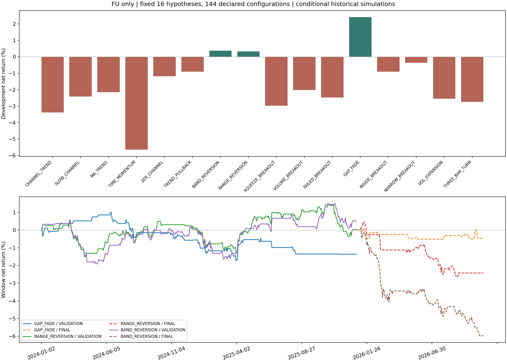
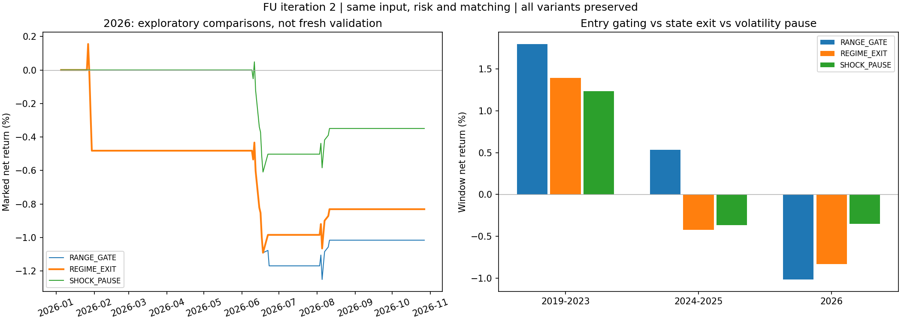

# 燃料油FU研究日志：机制对照、失败归因与冻结观察版

日期：2026-10-27。专题继续保持SHFE.FU。已完成两轮514个配置/资金/成本/时间窗口场景，覆盖16类机制及其修正，并准备按新数据推进的诊断影子账本。目前没有规则取得有效性认证，观察版也不是实盘策略。

## 研究实际做了什么

本次先主动补数据，再做第一轮机制对照和第二轮失败修正。不是从前几个亏损结果就结束，也不把重复参数和资金情形冒称为不同的新策略。

- 主动查询天勤长历史。首次全历史请求因换月双腿不足失败，限定2019年起重新请求成功：1894根日线，2019-01-02至2026-10-27，34个真实交割合约、33次换月。
- 严格核对新合约开盘与换月新腿、时序、OHLC和规格；与旧快照重叠599根价格及合约标识完全一致。研究源单独冻结，不覆盖原业务行情或旧研究。
- 第一轮16类机制，三种邻近尺度和两种预定修正，共144配置；加入基准/双倍成本及方向控制、后续窗口、4倍成本和信号延迟，共398个场景。
- 第二轮根据开发交易的损失归因，对两类反转机制加入横盘门控、状态失效退出和波动扩张暂停，共116个场景。它属于看过第一轮结果后的探索，所有历史窗口均已使用，不重新标为新样本外证明。
- 保存全部配置、成绩、逐笔交易、日线资金曲线和失败原因；规则选择和未通过的结果都保留。

## 合约与执行边界

研究的是上期所燃料油FU。缓存34个合约均为每手10吨、最小变动1元/吨，与[上期所燃料油业务细则](https://www.shfe.cn/regulation/exchangerules/productrules/202512/t20251231_829966.html)一致。这个引用只核对合约单位和跳动，不证明策略能盈利。

主诊断资金100万元，另比较1万、10万元。每笔预算为当前净值与初始资金较低者的0.5%，保证金占比≤20%，名义敞口≤2倍，整数手向下取整。不加已有仓位，盈利后本轮不提高风险基数。

只在完成日线后生成信号，下一根开盘模拟成交。信号用已发生换月开盘价比率作因果归一化，执行用真实交割合约原价；换月平旧仓、不自动开新。默认2ATR14保护、4ATR目标，同根双触先止损。费用用缓存每手佣金与名义金额万分之一中较高者；市价和止损每次1跳不利滑点。止盈目标向外取有效跳动，保护向入场方向取整。窗口末按收盘假设清算并单列。

历史逐日费率、平今差异、保证金调整、涨跌停及排队信息仍不完整。现金不计利息，资金机会成本未计；回撤为收盘回撤。止损可能跳空超预算，实际账本也保留了这类损失，没有裁剪为0.5%。所以这里是条件性历史执行研究，不是历史实盘重现。

## 冻结的时间顺序

开发：2019年统一80根预热后至2023年末，实际评分从2019-05-07起；固定规则分三段看稳定性，持仓与资金连续，不把它称为各段重新优化的walk-forward。

后续检验：2024-2025。最后检验：2026-01-05至2026-10-27。第一轮先只用开发数据固定三个不同机制，再打开后两个窗口，没有在2026看到输赢后换候选。部分年份此前在项目别的研究中使用，不能声称从未被研究。第二轮更明确属于事后探索；真正前瞻只能来自冻结后的新行情。

第一轮用联合10日分块、去均值、1000次固定种子的max-Sharpe自助检验，考虑144次配置尝试。它是依赖样本和平稳性假设的条件性近似，不是获利概率。[CME多重检验材料](https://www.cmegroup.com/content/dam/cmegroup/education/files/backtesting.pdf)说明了重复尝试对成绩解释的影响。

## 第一轮：16个机制全部完成

以下为核心100万元账户2019-2023整个开发窗口的累计净收益率，不是年化，不是未来收益预测。

| 机制 | 基准完整交易 | 基准净收益 | 双倍成本 | 低波动过滤修正 | 盈利目标修正 |
| --- | ---: | ---: | ---: | ---: | ---: |
| 顺势20日突破 | 57 | -3.385% | -3.848% | -2.778% | -2.417% |
| 慢55日突破 | 38 | -2.419% | -2.530% | -2.609% | -0.664% |
| 双均线跟随 | 142 | -2.148% | -3.285% | -3.313% | -0.626% |
| 定周期动量 | 149 | -5.652% | -6.630% | -5.798% | -4.636% |
| 波动通道突破 | 74 | -1.190% | -1.594% | -1.469% | -1.315% |
| 顺势回撤 | 16 | -0.910% | -0.994% | -0.987% | -0.950% |
| 均值回归 | 98 | +0.372% | -0.173% | -0.469% | +0.376% |
| 区间位置反转 | 133 | +0.326% | +0.049% | +0.500% | +0.436% |
| 收敛后突破 | 41 | -2.982% | -3.302% | -3.153% | -1.419% |
| 放量突破 | 34 | -2.022% | -1.798% | -2.181% | -3.018% |
| 假突破反转 | 32 | -2.481% | -2.685% | -2.487% | -2.481% |
| 跳空失败回归 | 97 | +2.413% | +1.690% | +3.184% | +2.546% |
| 内包后突破 | 60 | -0.903% | -1.246% | +0.281% | +1.065% |
| 窄幅后突破 | 63 | -0.358% | -0.678% | -0.237% | +1.060% |
| 波动扩张确认 | 67 | -2.553% | -3.390% | -2.971% | +0.979% |
| 连跌连涨后转向 | 197 | -2.743% | -3.765% | -2.026% | -2.720% |

预定修正具体是：入场增加ATR14≤1.25ATR60；或趋势组目标4ATR改8ATR、反转组改2ATR。止损和风险预算保持，不能靠放宽亏损容忍或提高杠杆制造修正成功。三种尺度只检查邻域，选择仍用中心尺度。

初步经验：某些趋势规则延长盈利目标后亏损缩小，但没有因此都转盈；低波动过滤有时改善、有时恶化。跳空回归开发成绩较好，也不能免于后续检验。

### 开发阶段固定的三个候选

| 机制与形式 | 2024-2025净收益 | 同期双倍成本 | 2026净收益 | 2026双倍成本 | 2026交易数 |
| --- | ---: | ---: | ---: | ---: | ---: |
| 跳空失败回归 / BASE | -1.362% | -1.644% | -0.459% | -0.509% | 13 |
| 区间位置反转 / QUIET_FILTER | +0.026% | +0.055% | -2.422% | -2.478% | 16 |
| 均值回归 / BASE | +0.516% | +0.562% | -5.972% | -5.319% | 23 |

跳空回归的开发累计收益约+2.413%，进入后续年份转亏。区间反转加波动过滤，2024-2025近乎持平，2026明显失效；布林型均值回归也在2026损失扩大。开发多重尝试校正p值分别约0.987、1.000、1.000，不能把开发成绩看成强证据。

完整观察门槛包括交易数、跨段与邻域稳定性、双倍成本、去掉最好一笔后的成绩、收盘回撤以及多重尝试校正；三个候选均未通过。没有为了继续给出“可用策略”而降低门槛。

部分双倍成本成绩略好，是因为风险预算计入成本后手数与部分交易改变，少承担了某些亏损；不表示费用增加本身有利。对账按各自真实模拟手数和费用分别核对。

## 第二轮：先找失败形态，再检验修正

没有把“2026反转失效”直接改写成一个肯定赚钱的过滤器。先只用早期开发交易，按入场前已经可得的abs(SMA20−SMA60)/ATR14分组：

| 开发归因 | ≤0.5ATR的交易/净盈亏 | 0.5至1ATR的交易/净盈亏 | >1ATR的交易/净盈亏 |
| --- | ---: | ---: | ---: |
| 区间反转 | 27笔 / +22997.34元 | 26笔 / −19692.02元 | 80笔 / −49.14元 |
| 布林型均值回归 | 18笔 / −13255.83元 | 19笔 / −7052.81元 | 61笔 / +24033.40元 |

这只是开发归因，不是独立的因果结论。它给出的可检验方向是：横盘门控也许适合区间反转，但对另一种均值回归可能适得其反。所以两类一起检验并保留反例。

冻结三种修正：RANGE_GATE只在均线分离≤0.5ATR时开仓；REGIME_EXIT在此基础上，横盘条件消失也于下一根开盘退出；SHOCK_PAUSE再要求ATR14≤1.25ATR60，任一条件消失触发退出。各自三种尺度，不能根据最后窗口再挑阈值。

以下列出所有中心修正，不只展示最好的一项。每个数都是相应窗口累计净收益率：

| 原机制 | 修正 | 2019-2023 | 2024-2025 | 2026 |
| --- | --- | ---: | ---: | ---: |
| 区间位置反转 | RANGE_GATE | +1.800% | +0.536% | -1.016% |
| 区间位置反转 | REGIME_EXIT | +1.397% | -0.422% | -0.831% |
| 区间位置反转 | SHOCK_PAUSE | +1.236% | -0.365% | -0.349% |
| 均值回归 | RANGE_GATE | +0.506% | +1.292% | -1.101% |
| 均值回归 | REGIME_EXIT | -0.338% | -0.120% | -0.736% |
| 均值回归 | SHOCK_PAUSE | -0.338% | -0.089% | -0.499% |

开发标准选出的观察版为RANGE_REVERSION / REGIME_EXIT，而不是在2026表格里挑损失最小者。它开发有34笔交易，2024-2025只有12笔，2026只有4笔。完整规则和预算已冻结为FU-R2诊断观察版。

需要诚实区分改善与证据：新规则相对首轮区间反转少亏，但其中入场门控和退出都改变，不能把全部差异归因于退出。只比较RANGE_GATE与REGIME_EXIT：提前退出在2026缩小损失，却使2024-2025由小赚变为亏损。交易数减少也使结论更不确定。

## 不同资金规模与当前观察状态

在FU-R2同一0.5%单笔预算、20%保证金上限与2ATR保护下，1万元和10万元在2024-2025、2026均不足一手而无交易。100万元诊断账户可以执行，但没有得到稳定正收益。这里的空仓是这些约束下的执行结果，不证明小资金在任何周期都无法交易，也不能提高风险率凑一手来掩盖问题。

已初始化本地诊断影子账本，冻结日期2026-10-27，虚拟初始资金100万元；当前信号HOLD、空仓，零前瞻交易、零实际委托。它不连接券商或生产模拟账户，也没有启动后台监测。

新增完成日线后可按同一冻结规则推进：持仓跨日延续，记录平仓与浮动盈亏，重复同一数据不会重复成交；旧行情改写或规则被改动会拒绝推进。它仍是基于日线的事后到达数据回放，不是盘口真实成交。一次补入多日数据也不会冒充每天当时在线执行。

更新入口：python scripts/refresh_fu_research_input.py。
推进入口：python scripts/advance_fu_observation.py --input .test-tmp/fu-latest-audited.json。

两条命令已用现有数据服务真实跑通，重复刷新到同一日期后账本revision仍为0、没有虚构成交。初始研究快照与候选规则保留，不因刷新而重算历史选股/规则。

## 从这两轮得到的经验，以及下一步

1. 同一个过滤器在不同入场机制上可以有相反效果，必须保留反例。不能把“横盘适合反转”当作不需验证的口号。
2. 退出规则存在取舍。减少一个窗口的亏损可能同时减少另一个窗口的盈利，样本变少也会使曲线看起来更平。
3. 每次失败应留下可复核原因：无交易、样本不足、费用敏感、邻域不稳、跨年份变号、最好一笔贡献过大、状态变化后继续逆势等，而不是只记“亏了”。
4. 多次尝试值得做，但必须记录总尝试量和样本消耗；514是配置/情形数量，不是514个互相独立的新发现。第二轮没有再次取得“未见样本”身份。
5. 观察账本用于约束下一次改口，后续规则改变必须新建版本，不能把已经知道的2026走势回填成先见之明。

下一批机制仍聚焦燃油：优先区分原油共同方向与燃油自身相对变化，再研究期限结构对同一价格信号的影响；需要燃油各交割月逐日收盘/结算和真实时点价差，而不仅是主力一条线。交易标的仍为FU，其他数据只作解释和条件检验。历史费用、平今与保证金变更也需逐步补齐。现有数据接口已经可用于继续采集，不要求用户先找更多网文。

## 验证与完整记录

80项定向测试通过。独立重算两轮27097条完整交易记录的价差、方向、乘数、手数和双边费用，均与账本一致。它们含参数、成本、资金和窗口重复情形，不是27097个独立样本。代码与协议指纹核对通过，所有入场对应前一根已完成信号，计划风险不超过预算；跳空超预算损失如实保留。

首个执行尝试在计算完成后因NumPy布尔值不能序列化而未能保存最终账本。该尝试的协议、选择、统计输出和原代码已保留，恢复只修复数值序列化类型；前后开发选择和bootstrap结果完全相同，没有改参数或数据。恢复重算不计作新增研究尝试。

- [第一轮冻结协议与144个图](data/fu-focused-2026-10-27-r2/manifest.json)
- [第一轮398场景汇总](data/fu-focused-2026-10-27-r2/all-runs.csv)
- [逐机制失败与修正日志](data/fu-focused-2026-10-27-r2/failure-journal.json)
- [第一轮完整账本](data/fu-focused-2026-10-27-r2/full-ledgers.json.gz)
- [第二轮116场景汇总](data/fu-regime-2026-10-27/all-runs.csv)
- [第二轮完整账本](data/fu-regime-2026-10-27/full-ledgers.json.gz)
- [FU-R2冻结观察版](data/fu-regime-2026-10-27/observation-candidate.json)
- [当前影子账本](data/fu-regime-2026-10-27/shadow-state.json)
- [独立对账记录](data/fu-focused-2026-10-27-r2/verification.json)
- [冻结原始行情快照](data/fu-focused-2026-10-27-r2/source-snapshot.json.gz)

主要复现入口：scripts/research_fuel_focused.py、scripts/research_fuel_iteration.py。已有实验拒绝覆盖；前者若重跑使用新的output目录，后者固定目录用于保留本次探索记录，不能用重跑覆盖它。后续新版本另立协议、输出目录和时间界限。
